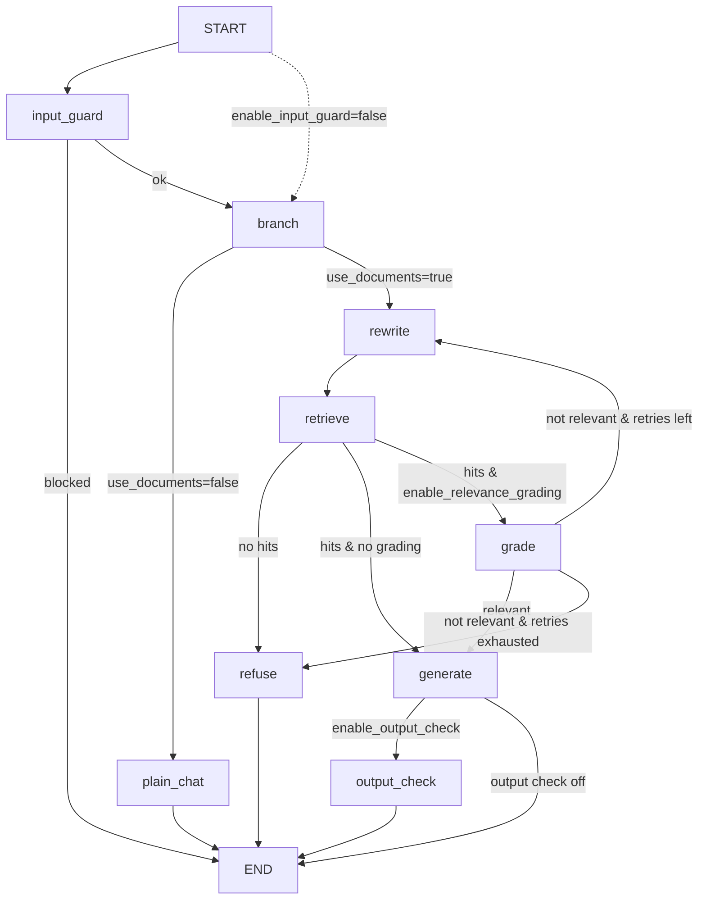

# RAG StateGraph Overview

The chat pipeline is a **LangGraph `StateGraph`** (`app/graph/`). Nodes orchestrate retrieval, optional guardrails, generation, and refusals. The FastAPI chat route streams custom events via `rag_graph.astream(..., stream_mode="custom")`.

## Mermaid diagram

## Node descriptions

* **`input_guard`** (flag: `enable_input_guard`) – Normalises the question (control chars, length), applies a small regex injection speed bump, and on block streams `I can't help with that request.` plus `{status: blocked}` without calling retrieval or the LLM. Logs the pattern name only.
* **`plain_chat`** – When `use_documents=False`, streams a normal chat completion (no RAG).
* **`rewrite`** – Standalone query via `rewrite_question`; on retrieval retry uses the original question for a broader search.
* **`retrieve`** – Embeds, searches Chroma, filters by `min_score`, builds context/sources, emits `{status}`.
* **`grade`** (flag: `enable_relevance_grading`) – One temperature-0 `complete()` yes/no relevance check on top chunks; fail-open on errors; may loop to `rewrite` until `max_retrieval_retries`. Emits `Checking relevance...`.
* **`generate`** – `build_messages` (optionally reordered) + streamed answer; emits tokens and sources.
* **`output_check`** (flag: `enable_output_check`) – Post-stream citation/number checks only; emits `{verification}`; never changes the answer.
* **`refuse`** – Streams `I couldn't find that in the uploaded documents.` with empty sources (no answer LLM).

Guardrail logic lives in `app/graph/guards.py`. The graph is compiled once at import in `app/graph/builder.py`; changing flags requires a process restart.