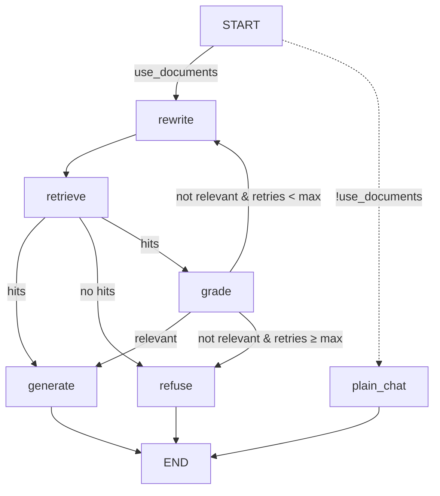

# RAG StateGraph Overview

The chatbot’s processing pipeline is now expressed as a **LangGraph `StateGraph`**.  
All business‑logic (rewriter, embedder, vector store, prompt builder, LLM) lives in
the individual nodes; the graph orchestrates the flow and decides which path to take.

## Mermaid diagram

## Node descriptions (5 lines)

* **`plain_chat`** – When `use_documents=False`, builds a simple system+history+user message and streams the LLM answer directly (no retrieval).  
* **`rewrite`** – Calls `rewrite_question` to turn a follow‑up into a standalone query; skips when there is no prior history.  
* **`retrieve`** – Embeds the (rewritten) question, searches the Chroma vector store (`vector_search`), filters by `min_score`, builds `context` and a `sources` payload, and emits a `{status}` event.  
* **`grade`** (Phase‑2, enabled by `settings.enable_relevance_grading`) – Sends a short “yes/no” LLM prompt: “Does the context contain the answer?”; sets `state["relevant"]` and handles retry counting.  
* **`generate`** – Constructs the final grounded prompt with `build_messages`, streams tokens from `stream_chat`, and finally emits the `{sources}` payload.  
* **`refuse`** – When no hits survive the score filter (or after exhausted retries), streams the “I couldn't find that …” message as token events and sends an empty `sources` list.

The graph is compiled once (`rag_graph = build_graph()`) in `app/graph/builder.py` and invoked from the FastAPI chat endpoint via `rag_graph.astream(state, stream_mode="custom")`. This keeps the observable SSE behaviour unchanged while giving us a clear, extensible workflow.